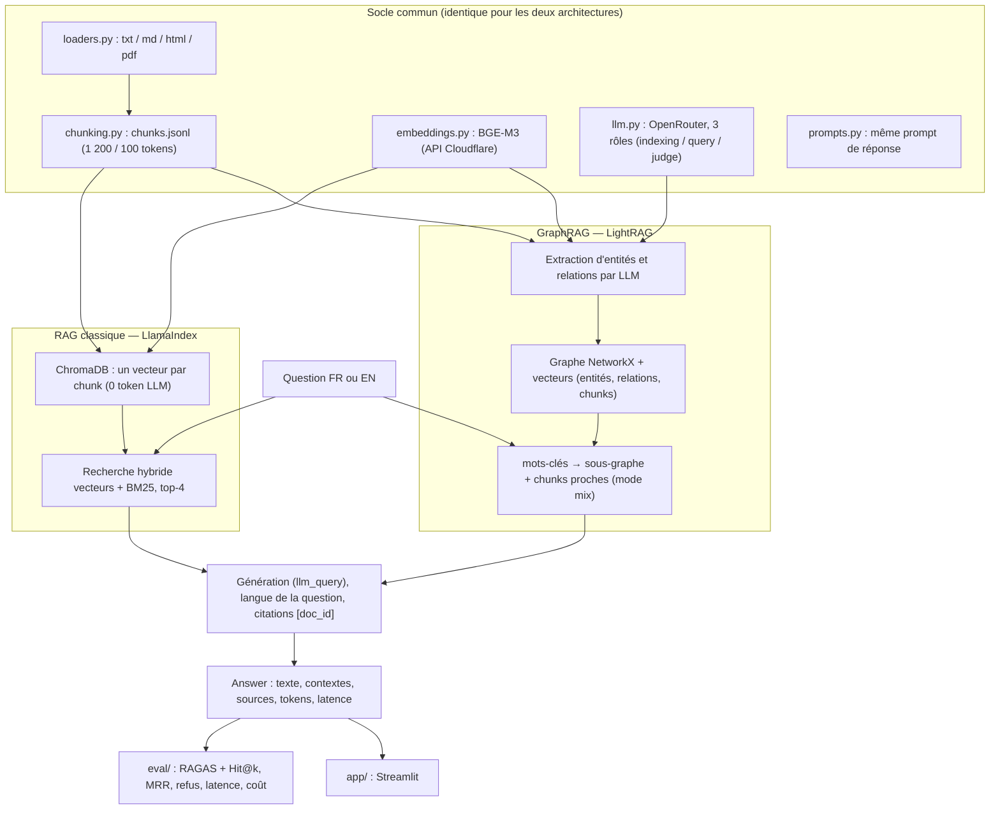
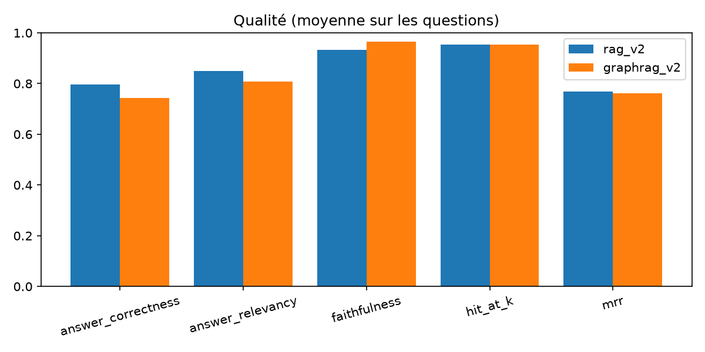
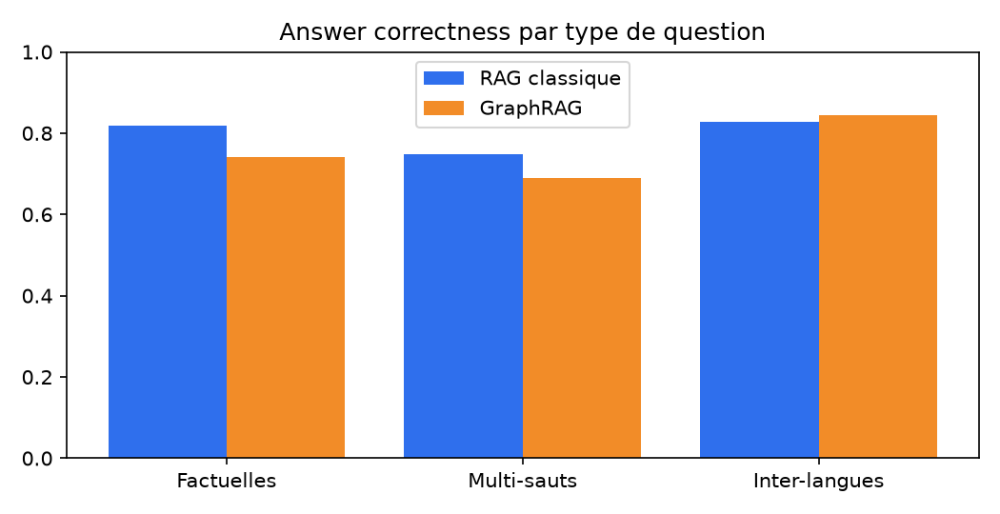
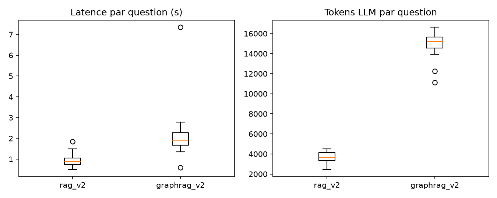

# Assistant UHA — RAG classique vs GraphRAG

> Projet de module — Master 1 Data Science, Université de Haute-Alsace — novembre 2026.
> Équipe : Mohamed Aziz, Amar, Naima, Lisa. Dépôt : https://github.com/Mohamed-Aziiz/RAG_UHA

Assistant intelligent pour exploiter les ressources documentaires de l'UHA (formations, règlements,
vie étudiante), en **français et en anglais**. Deux architectures sont implémentées sur les mêmes
données et comparées expérimentalement :

- un **RAG classique** (LlamaIndex + ChromaDB), qui sert de référence ;
- un **GraphRAG** (LightRAG, graphe de connaissances NetworkX), qui structure les documents en
  entités et relations avant la recherche.

<!-- Les blocs marqués ⟨à compléter⟩ sont remplis à partir des résultats réels (voir §7). -->

## 1. Description et objectifs

Le sujet initial était un assistant RAG sur les documents de l'UHA. L'encadrant a demandé
d'explorer une approche plus avancée, le **GraphRAG**, en conservant le RAG classique comme
référence, et de comparer les deux selon quatre axes :

| Axe | Question posée |
| --- | --- |
| Pertinence des réponses | La réponse traite-t-elle la question et correspond-elle à la réponse attendue ? |
| Fiabilité | La réponse est-elle fidèle aux sources (pas d'hallucination) ? Le système sait-il refuser quand il ne sait pas ? |
| Qualité de la récupération | Les bons documents sont-ils retrouvés, y compris quand la question et le document ne sont pas dans la même langue ? |
| Performances | Latence, tokens consommés, temps et coût d'indexation. |

Contraintes de conception : démo simple (une page Streamlit), aucun serveur ni Docker, tout
configurable dans un fichier, exécutable sous Windows, budget de quelques euros (API payées à l'usage).

## 2. Données

**Provenance.** Pages du site de l'Université de Haute-Alsace (uha.fr et sites des composantes),
collectées par scraping (script hors dépôt), sur trois thèmes qui se recoupent : formations,
règlements et procédures, vie étudiante. Les fichiers sont conservés dans leur format d'origine
(`.html`, `.pdf`, `.md`, `.txt`) dans `data/raw/`, avec un fichier `documents.csv`
(`doc_id,title,source,lang`) qui garde l'URL d'origine de chaque document.

**Volume.** **108 chunks** après nettoyage ; ⟨nombre de documents FR / EN et de tokens à reprendre
de `data/chunks/stats.json`⟩. Le corpus est volontairement petit : il est dimensionné pour que
l'indexation du graphe (le poste le plus coûteux, ≈ 4 900 tokens de LLM par chunk mesurés) reste
rapide et peu chère.

**Nettoyage.** Les pages « les news du sup » (actualités datées, hors des trois thèmes) sont exclues
par `corpus.exclude` dans la configuration : elles concurrençaient les pages de référence dans la
recherche. Chunks, index et graphe ont été reconstruits sans elles.

Le quota gratuit de Groq, utilisé au départ, s'est révélé insuffisant (≈ 200 000 tokens par jour et
par modèle) et son offre payante était fermée aux nouveaux comptes : tous les LLM passent par OpenRouter.

**Préparation** (`scripts/build_chunks.py`) :
1. chargement par format — HTML nettoyé avec *trafilatura* (menus et pieds de page retirés), PDF
   avec *PyMuPDF* (respecte l'ordre de lecture, contrairement à *pypdf*), texte brut tel quel ;
2. détection de la langue (*langdetect*), ou langue forcée dans `documents.csv` ;
3. découpage commun en chunks de **1 200 tokens avec 100 de recouvrement** (tiktoken), identifiant
   stable `<doc_id>::<n>`. **Les deux architectures utilisent exactement ces chunks.**

Les données et les index ne sont pas dans Git (`data/` est ignoré) ; ils sont partagés sous forme
de zips versionnés (voir §5).

## 3. Approche



**Ce qui est identique** (condition d'une comparaison équitable) : les chunks, le modèle
d'embeddings, le LLM de génération, le prompt de réponse (`prompts.py`), le format de sortie
`Answer`. **Ce qui diffère** : l'index et la recherche.

**RAG classique** (`pipelines/rag.py`). Chaque chunk est embarqué avec BGE-M3 et stocké dans
ChromaDB. À la question : recherche **hybride**. On prend 50 candidats par similarité cosinus et 50 par BM25
(termes exacts : sigles, noms de services). La fusion garde le premier passage vectoriel, puis les
2 meilleurs passages BM25, puis complète avec les passages vectoriels, pour 4 passages (k = 4).
Vient ensuite la génération. Coût d'indexation : zéro appel de LLM.

**GraphRAG** (`pipelines/graphrag.py`, `indexing/graph_index.py`). À l'indexation, LightRAG
envoie chaque chunk au LLM pour en extraire des entités typées (Formation, Composante, Service,
Procédure…) et des relations, puis fusionne les descriptions d'une même entité vue dans plusieurs
chunks. Le graphe est stocké en GraphML (NetworkX) ; entités, relations et chunks sont aussi
embarqués. À la question : extraction de mots-clés (1 appel LLM), recherche des entités et
relations proches et des chunks proches de la question (mode `mix` = graphe local + global +
recherche vectorielle des chunks), puis génération avec le **même prompt** que le RAG, enrichi d'un
résumé du sous-graphe.

Choix d'implémentation notables :
- chaque chunk commun est inséré dans LightRAG comme un document avec `file_paths=[chunk.id]`, ce
  qui garantit les mêmes chunks des deux côtés et donne la source de chaque passage sans
  rapprochement ;
- extraction en mode JSON et descriptions en anglais (langue pivot), noms d'entités dans leur forme
  officielle avec sigle, pour limiter les doublons FR / EN ;
- `entity_extract_max_gleaning: 0` (un seul passage d'extraction), pour limiter le coût d'indexation ;
  le cache LLM permet de reprendre une indexation interrompue ;
- `max_total_tokens: 20000` : à 5 000, les tableaux d'entités et de relations saturaient le budget de
  contexte et LightRAG ne remontait aucun passage sur 23 questions sur 25 ;
- mode `mix` choisi sur le jeu de validation (meilleure correctness que `hybrid`, aucun refus à tort) ;
- rééquilibrage des mots-clés : un mot-clé de bas niveau présent dans au moins la moitié des passages
  (« UHA ») est déplacé vers les mots-clés de haut niveau, pour qu'il ne domine pas la recherche des entités ;
- `kg_chunk_pick_method: WEIGHT` : les passages liés aux entités sont choisis dans l'ordre des entités
  trouvées, et non par similarité avec la question brute (un mot présent partout, « UHA », faisait
  passer les pages génériques devant le bon passage).

## 4. Modèles utilisés

| Rôle | Modèle | Fournisseur | Pourquoi |
| --- | --- | --- | --- |
| Indexation du graphe (`llm_indexing`) | `openai/gpt-oss-120b` | OpenRouter | extraction d'entités et de relations de meilleure qualité qu'avec le 20b, pour un coût de quelques centimes |
| Génération des réponses (`llm_query`) | `openai/gpt-oss-120b` | OpenRouter | qualité ; **commun aux deux architectures** |
| Juge RAGAS (`llm_judge`) | `qwen/qwen3.8-27b` (réflexion désactivée) | OpenRouter | différent du générateur, pour éviter l'auto-évaluation |
| Embeddings | `@cf/baai/bge-m3` (1 024 dim.) | Cloudflare Workers AI | multilingue FR ↔ EN ; par API, rien à télécharger |

Tous les modèles sont appelés via une API compatible OpenAI ; chaque rôle se change dans
`configs/config.yaml` (`base_url` + `model`), par exemple vers un modèle local Ollama, sans
modifier le code. Modèles à raisonnement : `reasoning_effort: low`, `temperature: 0`.

## 5. Installation (Windows, PowerShell)

Prérequis : [Python 3.11](https://www.python.org/downloads/), [uv](https://docs.astral.sh/uv/), Git.

```powershell
git clone https://github.com/Mohamed-Aziiz/RAG_UHA.git
cd RAG_UHA
uv python pin 3.11
uv sync                          # crée .venv et installe tout (pas de PyTorch : embeddings par API)
uv run nbstripout --install      # nettoie les sorties des notebooks avant chaque commit
Copy-Item .env.example .env      # puis remplir OPENROUTER_API_KEY, CF_ACCOUNT_ID, CF_API_TOKEN
uv run python scripts/check_setup.py --ping   # vérifie config, clés, et fait un appel réel à chaque API
uv run pytest -q                 # tests hors ligne (32 tests, ~10 s)
```

Clés nécessaires : [OpenRouter](https://openrouter.ai/keys) (paiement à l'usage ; tout le projet coûte moins de 1 $) et
[Cloudflare Workers AI](https://developers.cloudflare.com/workers-ai/get-started/rest-api/)
(identifiant de compte + jeton API « Workers AI »).

**Récupérer les artefacts sans rien recalculer** (index ChromaDB, graphe LightRAG, runs) :
télécharger les zips du Drive ⟨lien à compléter⟩ dans un dossier, puis

```powershell
uv run python scripts/unpack_artifacts.py --from "C:\chemin\vers\les\zips" --version v1
```

## 6. Lancer la démo

```powershell
uv run streamlit run app/streamlit_app.py
```

Une page : zone de question, choix **RAG / GraphRAG / Les deux** (côte à côte), réponse avec
citations, passages sources, latence et tokens ; pour le GraphRAG, les entités et relations
utilisées et un sous-graphe interactif (pyvis). Un **mode hors ligne** rejoue des réponses
enregistrées (`scripts/record_demo.py`) si l'API est indisponible. Le nom de l'assistant, le logo et
les couleurs se règlent dans `configs/config.yaml` (`app:`) et `.streamlit/config.toml`.

## 7. Reproduire les expériences

Dans l'ordre, chaque script lit `configs/config.yaml` et accepte `--config` :

| Étape | Commande | Coût / durée attendus |
| --- | --- | --- |
| 1. Chunks | `uv run python scripts/build_chunks.py` | quelques secondes, 0 token |
| 2. Index RAG | `uv run python scripts/build_vector_index.py` | ≈ 1 min, 0 token LLM, ~100 k tokens d'embeddings |
| 3a. Test du graphe | `uv run python scripts/build_graph.py --limit 3` | mesure réelle : tokens/chunk, durée |
| 3b. Graphe complet | `uv run python scripts/build_graph.py` | ≈ 5 000 tokens LLM / chunk ; relançable (reprise) |
| 3c. Stats du graphe | `uv run python scripts/build_graph.py --stats` | entités par type, doublons FR/EN probables |
| 4. Réponses | `uv run python scripts/run_eval.py --pipeline rag` puis `--pipeline graphrag` | ≈ 6 k tokens / question / pipeline |
| 5. Juge | `uv run python scripts/judge.py --run rag --limit 2` (test), puis sans `--limit`, puis `--run graphrag` | ≈ 20 k tokens / question / pipeline |
| 6. Tableaux | `uv run python scripts/make_report.py` | → `eval/results/results.md`, CSV, figures |
| 7. Diagnostic | `uv run python scripts/diagnose_eval.py --run rag` (`--show <id>` pour une question) | cause de chaque échec ; 0 token LLM avec `--no-embed` |

Résultats principaux du §9 (jeu v2) :

```bash
uv run python scripts/run_eval.py --questions eval/questions_v2.jsonl --check
uv run python scripts/run_eval.py --pipeline rag --questions eval/questions_v2.jsonl --tag v2
uv run python scripts/run_eval.py --pipeline graphrag --questions eval/questions_v2.jsonl --tag v2
uv run python scripts/judge.py --run rag_v2          # relancer une fois s'il reste des NaN
uv run python scripts/judge.py --run graphrag_v2
uv run python scripts/make_report.py --runs rag_v2 graphrag_v2
```

Options utiles : `scripts/ask.py "question" --pipeline both` pour une question isolée ;
`run_eval.py --mode mix --tag mix` pour une variante GraphRAG ; `--pause 10` en offre gratuite.
Tous les scripts longs reprennent là où ils se sont arrêtés (cache LightRAG, JSONL de run et de scores).

## 8. Protocole d'évaluation

**Trois jeux de questions**, rédigés à partir des documents (jamais à partir des réponses d'un
pipeline), avec réponse de référence et documents attendus (`gold_docs`) :

| Fichier | Rôle | Questions |
| --- | --- | --- |
| `eval/questions_dev.jsonl` | **validation** : seul jeu utilisé pour régler les paramètres (mode LightRAG, prompt, fusion BM25) | 7 |
| `eval/questions.jsonl` | test v1 (22 questions après retrait de 3 questions ambiguës, voir `questions_retirees.jsonl`) | 22 |
| `eval/questions_v2.jsonl` | **test v2, résultats principaux** : références recopiées des sources, sans les pages d'actualités | 25 |

Répartition du jeu v2 :

| Catégorie | Nombre | Définition |
| --- | --- | --- |
| Factuelles FR / EN | 7 / 4 | réponse dans un seul passage |
| Multi-sauts FR / EN | 5 / 2 | au moins deux passages à relier, idéalement de deux documents |
| Inter-langues | 4 (2 FR → doc. EN, 2 EN → doc. FR) | question dans une langue, documents attendus dans l'autre |
| Hors corpus | 3 | la bonne réponse est un refus |

Mêmes questions, mêmes chunks, mêmes embeddings, même LLM de génération et même prompt pour les deux
pipelines. Les paramètres sont choisis sur la validation, puis chaque jeu de test est exécuté une
seule fois, sans réglage ensuite. Seule exception, annoncée : `llm_query.max_tokens` est passé de
700 (v1) à 1 500 (v2), parce que gpt-oss compte son raisonnement dans ce budget.

**Métriques** (`eval/metrics.py`, `eval/ragas_eval.py`) :

| Axe | Métrique | Calcul |
| --- | --- | --- |
| Pertinence | Answer relevancy | RAGAS : le juge régénère une question depuis la réponse, similarité avec la vraie question (une réponse évasive vaut 0) |
| Pertinence | Answer correctness | RAGAS : 0,75 × F1 sur les affirmations (réponse vs référence) + 0,25 × similarité d'embeddings ; une information de la référence absente de la réponse est pénalisée |
| Fiabilité | Faithfulness | RAGAS : part des affirmations soutenues par **tout** ce que le LLM a reçu (passages, plus le résumé du sous-graphe pour le GraphRAG) |
| Fiabilité | Refus corrects / refus à tort | détection d'une formule de refus sur les questions hors corpus / répondables |
| Récupération | Hit@4, MRR, rappel des documents attendus @4 | au niveau du **document** (seul repère commun aux deux pipelines) ; k = 4 = nombre de passages du RAG |
| Performances | Latence médiane et p95, tokens, appels, coût pour 1 000 questions | mesurés par la couche LLM ; coût au tarif OpenRouter |
| Performances | Indexation | durée, tokens, coût, entités/relations, taille sur disque (`metadata.json`) |

Règles d'agrégation : les moyennes RAGAS portent sur les questions répondables ; la fidélité, sur les
réponses non refusées (RAGAS donne un score arbitraire à un refus). Quand le juge ne rend pas de
score (NaN, réponse mal formée), `judge.py` re-note la question au passage suivant : les moyennes
finales portent sur les mêmes questions des deux côtés.

Juge : `qwen/qwen3.8-27b`, température 0, réflexion désactivée. `scripts/diagnose_eval.py` classe
chaque échec (information absente du contexte → recherche ; présente dans le contexte mais pas dans
la réponse → génération ; refus à tort) et affiche le détail d'une question (`--show n18`).

## 9. Résultats

Résultats principaux : **jeu v2** (25 questions), `eval/results/results.md`.

### Tableau comparatif principal (v2)

| Axe | Métrique | RAG classique | GraphRAG (mix) |
| --- | --- | --- | --- |
| Pertinence | Answer relevancy ↑ | **0,851** | 0,809 |
| Pertinence | Answer correctness ↑ | **0,797** | 0,743 |
| Fiabilité | Faithfulness ↑ | 0,933 | **0,964** |
| Fiabilité | Refus corrects (hors corpus) ↑ | 3 / 3 | 3 / 3 |
| Fiabilité | Refus à tort (répondables) ↓ | 1 / 22 | **0 / 22** |
| Récupération | Hit@4 ↑ | 0,955 | 0,955 |
| Récupération | MRR ↑ | 0,769 | 0,761 |
| Récupération | Rappel des documents attendus @4 ↑ | 0,924 | 0,932 |
| Performances | Latence médiane (s) ↓ | **0,90** | 1,89 |
| Performances | Latence p95 (s) ↓ | **1,48** | 2,76 |
| Performances | Latence de la recherche seule (s) ↓ | **0,12** | 0,89 |
| Performances | Tokens LLM / question ↓ | **3 628** | 14 929 |
| Performances | Appels LLM / question ↓ | **1** | 2 |
| Performances | Coût pour 1 000 questions ($) ↓ | **0,12** | 0,48 |



### Par type de question et par langue (v2)

| Catégorie (n) | Correctness RAG | Correctness GraphRAG | Faithfulness RAG | Faithfulness GraphRAG | MRR RAG | MRR GraphRAG |
| --- | --- | --- | --- | --- | --- | --- |
| Factuelles (11) | **0,818** | 0,741 | 0,964 | 0,974 | 0,864 | 0,833 |
| Multi-sauts (7) | **0,747** | 0,689 | 0,917 | 0,929 | 0,690 | 0,702 |
| Inter-langues (4) | 0,827 | 0,844 | 0,875 | 1,000 | 0,646 | 0,667 |

| Langue de la question (n) | Correctness RAG | Correctness GraphRAG | Hit@4 RAG | Hit@4 GraphRAG |
| --- | --- | --- | --- | --- |
| Français (16, dont 3 hors corpus) | 0,781 | 0,780 | 0,929 | 1,000 |
| Anglais (9, dont 1 hors corpus) | **0,825** | 0,677 | 1,000 | 0,875 |



### Performances et coût d'indexation

| | RAG (ChromaDB) | GraphRAG (LightRAG) |
| --- | --- | --- |
| LLM d'indexation | aucun | `openai/gpt-oss-120b` |
| Tokens LLM | 0 | 531 345 (≈ 4 900 par chunk) |
| Appels LLM | 0 | 142 |
| Coût LLM estimé | 0 $ | 0,04 $ |
| Durée | 7,6 s | 895 s (≈ 15 min) |
| Entités / relations | — | 1 129 / 1 110 |
| Taille sur disque | 4,3 Mo | 26 Mo |



### Rappel : jeu v1 (22 questions)

| Métrique | RAG v1 | GraphRAG v1 | RAG v2 | GraphRAG v2 |
| --- | --- | --- | --- | --- |
| Answer correctness ↑ | 0,636 | **0,677** | **0,797** | 0,743 |
| Answer relevancy ↑ | 0,641 | **0,747** | **0,851** | 0,809 |
| Faithfulness ↑ | **0,883** | 0,844 | 0,933 | **0,964** |
| Refus à tort ↓ | 4 / 19 | **1 / 19** | 1 / 22 | **0 / 22** |
| Tokens / question ↓ | **3 338** | 15 797 | **3 628** | 14 929 |
| Latence médiane (s) ↓ | **0,86** | 2,05 | **0,90** | 1,89 |
| Coût pour 1 000 questions ($) ↓ | **0,11** | 0,50 | **0,12** | 0,48 |

### Statistiques du graphe

⟨`build_graph.py --stats` : entités par type, composantes connexes, nombre de paires d'entités
FR/EN probablement en double (similarité > 0,9), capture pyvis⟩

### Exemples commentés (v2)

**n07 — succès du GraphRAG (multi-sauts, FR).** *« Je veux devenir prof d'anglais : quel master
préparer à l'UHA, dans quelle faculté, et quand passe-t-on le concours ? »* Référence : master MEEF
spécialité Anglais, à la FLSH, concours pendant le M2.
- RAG (0,51) : ses 4 passages viennent des pages « masters » et « arts, lettres et langues ». Il
  propose le *Master Anglais* (faux) et déclare ne pas trouver la date du concours : c'est son seul
  refus à tort.
- GraphRAG (0,86) : en passant par le graphe, il remonte la page `metiers-de-l-enseignement`
  (4ᵉ document), que la recherche du RAG n'avait pas trouvée. La réponse est complète et sourcée.
- Le graphe relie la question à un document dont le vocabulaire est éloigné de la question : c'est
  le cas d'usage visé par le GraphRAG.

**n14 — succès du RAG (factuelle, EN).** *« How many components does UHA have? »* Référence :
8 composantes (4 facultés, 2 écoles d'ingénieurs, 2 IUT) sur 5 campus à Mulhouse et Colmar.
- Les deux pipelines classent le bon document en tête.
- RAG (0,78) : *« eight components — four faculties, two engineering schools and two institutes of
  technology »*.
- GraphRAG (0,38) : *« UHA is made up of 8 components »*. C'est exact (fidélité 1,0), mais il omet
  la ventilation alors qu'elle était dans son contexte.
- Même cas pour n03 (durée du doctorat) : le GraphRAG omet « au sein d'un laboratoire de recherche »
  (0,56 contre 0,95).
- Ce ne sont pas des hallucinations mais des réponses minimales. Answer correctness les pénalise
  parce que la référence contient ces détails.

**n18 — échec du GraphRAG (multi-sauts, EN).** *« Who runs continuing education at UHA, how many
programmes are there, and can they help with validation of prior experience? »* Référence : le
SERFA, près de 150 formations, accompagnement de la VAE.
- RAG (0,86) : la recherche hybride (vecteurs + BM25) trouve directement le passage anglais qui
  cite le SERFA. Les trois éléments sont donnés.
- GraphRAG (0,34, pertinence 0) : il s'appuie sur la page française générique `fr-formation-1`
  (« formation tout au long de la vie », VAE). Le document attendu n'arrive qu'au 6ᵉ rang, et le passage qui nomme
  le SERFA et le chiffre de 150 n'est pas dans le contexte. La réponse reste générique et déclare
  ne pas trouver le nombre de formations.
- L'extraction des mots-clés a aussi dû être relancée (3 appels, 6,2 s de recherche).

**n23 — refus correct des deux côtés (hors corpus).** *« Quel est le mot de passe du Wi-Fi de
l'UHA ? »* Les documents citent les réseaux eduroam et UHA, sans mot de passe. Les deux pipelines
répondent « Je ne trouve pas cette information dans les documents disponibles. » (vérifié à la main).

## 10. Analyse et limites

**Pertinence.** Sur le jeu v2, le RAG classique obtient la meilleure answer correctness (0,797 contre
0,743) et la meilleure pertinence (0,851 contre 0,809). L'écart est concentré : n03, n14 et n18
représentent à elles trois plus que tout l'écart, et sans elles les deux pipelines sont à égalité
(écart < 0,01 sur 19 questions). En français, la correctness est identique (0,781 contre 0,780) ;
l'écart vient des questions en anglais (0,825 contre 0,677), tiré par n14 et n18. Le GraphRAG gagne
nettement sur n07 (+0,35) et n05 (+0,12).

**Pourquoi le GraphRAG perd des points sur les factuelles.** La recherche n'est pas en cause : le bon
document est en tête dans les deux cas (n03, n14). Le GraphRAG envoie au LLM environ 15 passages,
plus les tableaux d'entités et de relations (≈ 15 000 tokens), contre 4 passages (≈ 3 600 tokens)
pour le RAG. Avec le même prompt, le modèle répond au minimum et laisse de côté des précisions que
la référence contient. C'est l'explication la plus probable ; un prompt différent par pipeline la
testerait, mais il casserait l'équité de la comparaison.

**Fiabilité.** Les deux pipelines sont fiables : fidélité ≥ 0,93, aucune réponse hors corpus
inventée, 3 refus corrects sur 3. Le GraphRAG est un peu plus fidèle (0,964 contre 0,933) et
refuse moins à tort sur les deux jeux (1/19 puis 0/22, contre 4/19 puis 1/22 pour le RAG). Son contexte plus large contient presque toujours
quelque chose à citer.

**Récupération.** Au niveau du document, les deux pipelines sont à égalité (Hit@4 0,955, MRR 0,77
contre 0,76). Ils ne ratent pas les mêmes questions : le RAG rate n07, où le vocabulaire de la
question est loin du document ; le GraphRAG rate n18, où une page française générique passe devant
le bon passage anglais. La recherche hybride vecteurs + BM25 rend le RAG solide sur les
termes exacts (sigles, noms de services).

**Performances.** C'est l'écart le plus net et le plus stable : le GraphRAG consomme 4 fois plus de
tokens par question, fait 2 appels au lieu d'un, répond 2 fois plus lentement (1,9 s contre 0,9 s) et
coûte 4 fois plus (0,48 $ contre 0,12 $ pour 1 000 questions). Il faut aussi 15 minutes et
531 000 tokens pour construire le graphe (0,04 $), contre 8 secondes sans LLM pour l'index vectoriel.

**v1 et v2 ne donnent pas le même classement.** Sur v1, le GraphRAG menait (0,677 contre 0,636),
surtout parce que le RAG refusait à tort 4 fois sur 19 : un refus coûte presque toute la
correctness et met la pertinence à 0. Sur v2, le RAG ne refuse plus qu'une fois et passe devant.
Deux choses ont changé en même temps : les questions (références recopiées des sources) et
`max_tokens` (700 → 1 500), donc on ne peut pas attribuer l'écart à l'une ou à l'autre. Conclusion
honnête : **sur ce corpus, la différence de qualité entre les deux pipelines est faible et dépend du
jeu de questions ; la différence de coût est grande et stable.**

**Bilan.** Pour un assistant documentaire de cette taille, où la plupart des questions sont
factuelles, le RAG classique hybride offre la meilleure qualité par euro. Le GraphRAG apporte un gain
réel sur un type de question précis : relier une question à un document qu'aucune recherche par
similarité ne trouve (n07). Il refuse aussi moins à tort. Ce gain se paie par 4 fois plus de tokens,
2 fois plus de latence et une indexation coûteuse.

**Limites.**
- **Taille des jeux.** 22 questions répondables : un écart de 0,05 de moyenne correspond à environ
  une question qui bascule. Aucune différence de qualité n'est statistiquement significative, d'où
  les exemples commentés.
- **Juge automatique.**
  - Juge LLM avec des consignes RAGAS en anglais.
  - Notes instables sur certaines questions d'un passage à l'autre.
  - Réponses parfois mal formées (NaN, re-notées ensuite).
  - Answer correctness pénalise une réponse exacte mais plus courte que la référence (n14).
- **Construction du graphe.**
  - Un seul passage d'extraction (`gleaning 0`).
  - Doublons d'entités FR / EN détectés mais non fusionnés.
  - Corpus petit (108 chunks) : le graphe relie peu de documents entre eux.
- **Non-déterminisme.**
  - OpenRouter route les requêtes vers plusieurs hébergeurs du même modèle.
  - Une relance peut changer une réponse (±1 refus d'un run à l'autre).
- **Détection des refus par mots-clés.** Un refus partiel (n18) n'est pas compté comme refus.

## 11. Pistes

- Fusionner les entités en double FR / EN (candidats déjà listés par `--stats`).
- Limiter le contexte du GraphRAG (moins de passages, `max_total_tokens` plus bas), pour tester
  l'hypothèse de dilution sur la validation.
- Reranker (`bge-reranker`, déjà prévu dans la configuration) pour les deux pipelines.
- Jeu de questions plus grand, avec davantage de multi-sauts entre documents.
- Second juge, ou vérification manuelle plus large.

## 12. Structure du dépôt

```text
configs/config.yaml         toute la configuration (modèles, chemins, paramètres)
.env.example                clés API attendues (le .env réel n'est jamais commité)
.streamlit/config.toml      couleurs de l'interface
src/rag_uha/
  config.py, types.py       socle : configuration (pydantic) et types partagés (Chunk, Answer…)
  llm.py                    couche LLM unique : 3 rôles, retry 429, comptage des tokens, adaptateurs
  embeddings.py, tokens.py  BGE-M3 par API, compteur de tokens
  lexical.py                index BM25 et fusion (recherche hybride du RAG)
  loaders.py, chunking.py   chargement des documents et découpage commun
  prompts.py                prompt de réponse commun, types d'entités UHA
  indexing/vector_index.py  ChromaDB (RAG)
  indexing/graph_index.py   LightRAG : construction, reprise, metadata, stats, doublons
  pipelines/rag.py, graphrag.py, base.py   les deux pipelines, même interface
  eval/dataset.py, runner.py, metrics.py, ragas_eval.py, report.py
  viz.py                    sous-graphes pyvis
scripts/                    une étape = un script (check_setup, build_*, run_eval, judge, make_report, diagnose_eval, ask, record_demo, pack/unpack_artifacts)
app/streamlit_app.py        interface de démo
eval/questions_dev.jsonl    validation (réglages) ; questions.jsonl test v1 ; questions_v2.jsonl test v2
eval/results/               tableaux, figures et diagnostics
tests/                      32 tests hors ligne (doublures d'API)
notebooks/                  prototypage et figures (importent rag_uha)
data/                       données et artefacts — ignoré par Git, partagé en zips
```

## Références

- Guo et al., *LightRAG: Simple and Fast Retrieval-Augmented Generation*, 2024 — https://github.com/HKUDS/LightRAG
- Edge et al., *From Local to Global: A Graph RAG Approach to Query-Focused Summarization*, 2024
- LlamaIndex — https://docs.llamaindex.ai/ ; ChromaDB — https://docs.trychroma.com/
- Es et al., *RAGAS: Automated Evaluation of Retrieval Augmented Generation*, 2023 — https://docs.ragas.io/
- Chen et al., *BGE M3-Embedding*, 2024 — https://huggingface.co/BAAI/bge-m3
