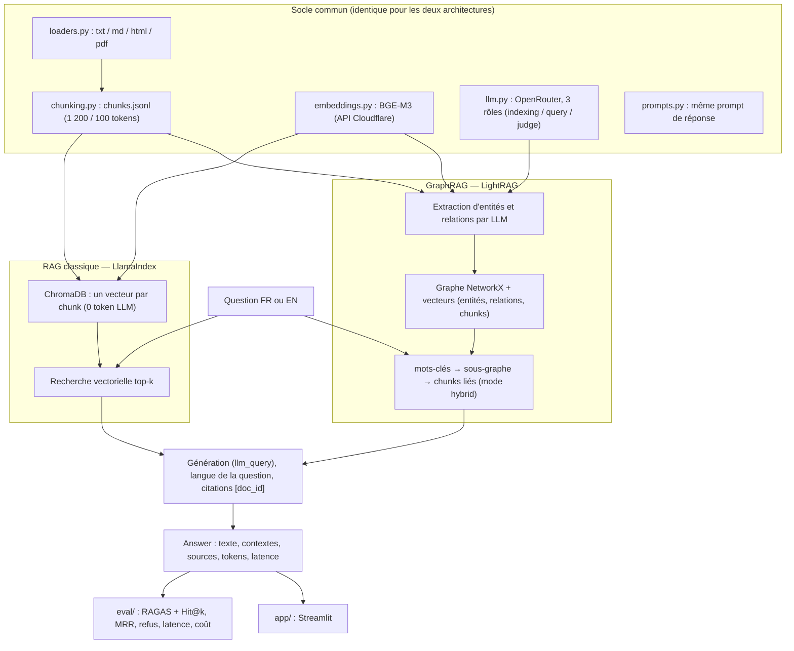

# Assistant UHA — RAG classique vs GraphRAG

> Projet de module — Master 1 Data Science, Université de Haute-Alsace — novembre 2026.
> Auteur : Mohamed Aziz. Dépôt : https://github.com/Mohamed-Aziiz/RAG_UHA

Assistant intelligent pour exploiter les ressources documentaires de l'UHA (formations, règlements,
vie étudiante), en **français et en anglais**. Deux architectures sont implémentées sur les mêmes
données et comparées expérimentalement :

- un **RAG classique** (LlamaIndex + ChromaDB), qui sert de référence ;
- un **GraphRAG** (LightRAG, graphe de connaissances NetworkX), qui structure les documents en
  entités et relations avant la recherche.

<!-- Les blocs marqués ⟨à compléter⟩ sont remplis à partir des résultats réels (voir §7). -->

## 1. Description et objectifs

Le sujet initial était un assistant RAG sur les documents de l'UHA. L'encadrant a demandé
d'explorer une approche plus avancée, le **GraphRAG**, en conservant le RAG classique comme
référence, et de comparer les deux selon quatre axes :

| Axe | Question posée |
| --- | --- |
| Pertinence des réponses | La réponse traite-t-elle la question et correspond-elle à la réponse attendue ? |
| Fiabilité | La réponse est-elle fidèle aux sources (pas d'hallucination) ? Le système sait-il refuser quand il ne sait pas ? |
| Qualité de la récupération | Les bons documents sont-ils retrouvés, y compris quand la question et le document ne sont pas dans la même langue ? |
| Performances | Latence, tokens consommés, temps et coût d'indexation. |

Contraintes de conception : démo simple (une page Streamlit), aucun serveur ni Docker, tout
configurable dans un fichier, exécutable sous Windows, budget de quelques euros (API payées à l'usage).

## 2. Données

**Provenance.** Pages du site de l'Université de Haute-Alsace (uha.fr et sites des composantes),
collectées par scraping (script hors dépôt), sur trois thèmes qui se recoupent : formations,
règlements et procédures, vie étudiante. Les fichiers sont conservés dans leur format d'origine
(`.html`, `.pdf`, `.md`, `.txt`) dans `data/raw/`, avec un fichier `documents.csv`
(`doc_id,title,source,lang`) qui garde l'URL d'origine de chaque document.

**Volume.** ⟨à compléter depuis `data/chunks/stats.json`⟩ : N documents (N FR / N EN), N tokens,
N chunks. Le corpus est volontairement petit : il est dimensionné pour que l'indexation du graphe
(le poste le plus coûteux, ≈ 3 300 tokens de LLM par chunk mesurés) reste rapide et peu cher.
Le quota gratuit de Groq, utilisé au départ, s'est révélé insuffisant (≈ 200 000 tokens par jour et
par modèle) et son offre payante était fermée aux nouveaux comptes : tous les LLM passent par OpenRouter.

**Préparation** (`scripts/build_chunks.py`) :
1. chargement par format — HTML nettoyé avec *trafilatura* (menus et pieds de page retirés), PDF
   avec *pypdf*, texte brut tel quel ;
2. détection de la langue (*langdetect*), ou langue forcée dans `documents.csv` ;
3. découpage commun en chunks de **1 200 tokens avec 100 de recouvrement** (tiktoken), identifiant
   stable `<doc_id>::<n>`. **Les deux architectures utilisent exactement ces chunks.**

Les données et les index ne sont pas dans Git (`data/` est ignoré) ; ils sont partagés sous forme
de zips versionnés (voir §5).

## 3. Approche



**Ce qui est identique** (condition d'une comparaison équitable) : les chunks, le modèle
d'embeddings, le LLM de génération, le prompt de réponse (`prompts.py`), le format de sortie
`Answer`. **Ce qui diffère** : l'index et la recherche.

**RAG classique** (`pipelines/rag.py`). Chaque chunk est embarqué avec BGE-M3 et stocké dans
ChromaDB. À la question : embedding de la question, top-k (k = 4) par similarité cosinus, puis
génération. Coût d'indexation : zéro appel de LLM.

**GraphRAG** (`pipelines/graphrag.py`, `indexing/graph_index.py`). À l'indexation, LightRAG
envoie chaque chunk au LLM pour en extraire des entités typées (Formation, Composante, Service,
Procédure…) et des relations, puis fusionne les descriptions d'une même entité vue dans plusieurs
chunks. Le graphe est stocké en GraphML (NetworkX) ; entités, relations et chunks sont aussi
embarqués. À la question : extraction de mots-clés (1 appel LLM), recherche des entités et
relations proches (mode `hybrid` = local + global), remontée des chunks liés, puis génération avec
le **même prompt** que le RAG, enrichi d'un résumé du sous-graphe.

Choix d'implémentation notables :
- chaque chunk commun est inséré dans LightRAG comme un document avec `file_paths=[chunk.id]`, ce
  qui garantit les mêmes chunks des deux côtés et donne la source de chaque passage sans
  rapprochement ;
- extraction en mode JSON et descriptions en anglais (langue pivot), noms d'entités dans leur forme
  officielle avec sigle, pour limiter les doublons FR / EN ;
- `entity_extract_max_gleaning: 0` (un seul passage d'extraction), pour limiter le coût d'indexation ;
  le cache LLM permet de reprendre une indexation interrompue ;
- `max_total_tokens: 20000` : à 5 000, les tableaux d'entités et de relations saturaient le budget de
  contexte et LightRAG ne remontait aucun passage sur 23 questions sur 25 ;
- `kg_chunk_pick_method: WEIGHT` : les passages liés aux entités sont choisis dans l'ordre des entités
  trouvées, et non par similarité avec la question brute (un mot présent partout, « UHA », faisait
  passer les pages génériques devant le bon passage).

## 4. Modèles utilisés

| Rôle | Modèle | Fournisseur | Pourquoi |
| --- | --- | --- | --- |
| Indexation du graphe (`llm_indexing`) | `openai/gpt-oss-120b` | OpenRouter | extraction d'entités et de relations de meilleure qualité qu'avec le 20b, pour un coût de quelques centimes |
| Génération des réponses (`llm_query`) | `openai/gpt-oss-120b` | OpenRouter | qualité ; **commun aux deux architectures** |
| Juge RAGAS (`llm_judge`) | `qwen/qwen3.8-27b` (réflexion désactivée) | OpenRouter | différent du générateur, pour éviter l'auto-évaluation |
| Embeddings | `@cf/baai/bge-m3` (1 024 dim.) | Cloudflare Workers AI | multilingue FR ↔ EN ; par API, rien à télécharger |

Tous les modèles sont appelés via une API compatible OpenAI ; chaque rôle se change dans
`configs/config.yaml` (`base_url` + `model`), par exemple vers un modèle local Ollama, sans
modifier le code. Modèles à raisonnement : `reasoning_effort: low`, `temperature: 0`.

## 5. Installation (Windows, PowerShell)

Prérequis : [Python 3.11](https://www.python.org/downloads/), [uv](https://docs.astral.sh/uv/), Git.

```powershell
git clone https://github.com/Mohamed-Aziiz/RAG_UHA.git
cd RAG_UHA
uv python pin 3.11
uv sync                          # crée .venv et installe tout (pas de PyTorch : embeddings par API)
uv run nbstripout --install      # nettoie les sorties des notebooks avant chaque commit
Copy-Item .env.example .env      # puis remplir OPENROUTER_API_KEY, CF_ACCOUNT_ID, CF_API_TOKEN
uv run python scripts/check_setup.py --ping   # vérifie config, clés, et fait un appel réel à chaque API
uv run pytest -q                 # tests hors ligne (24 tests, ~10 s)
```

Clés nécessaires : [OpenRouter](https://openrouter.ai/keys) (paiement à l'usage ; tout le projet coûte moins de 1 $) et
[Cloudflare Workers AI](https://developers.cloudflare.com/workers-ai/get-started/rest-api/)
(identifiant de compte + jeton API « Workers AI »).

**Récupérer les artefacts sans rien recalculer** (index ChromaDB, graphe LightRAG, runs) :
télécharger les zips du Drive ⟨lien à compléter⟩ dans un dossier, puis

```powershell
uv run python scripts/unpack_artifacts.py --from "C:\chemin\vers\les\zips" --version v1
```

## 6. Lancer la démo

```powershell
uv run streamlit run app/streamlit_app.py
```

Une page : zone de question, choix **RAG / GraphRAG / Les deux** (côte à côte), réponse avec
citations, passages sources, latence et tokens ; pour le GraphRAG, les entités et relations
utilisées et un sous-graphe interactif (pyvis). Un **mode hors ligne** rejoue des réponses
enregistrées (`scripts/record_demo.py`) si l'API est indisponible. Le nom de l'assistant, le logo et
les couleurs se règlent dans `configs/config.yaml` (`app:`) et `.streamlit/config.toml`.

## 7. Reproduire les expériences

Dans l'ordre, chaque script lit `configs/config.yaml` et accepte `--config` :

| Étape | Commande | Coût / durée attendus |
| --- | --- | --- |
| 1. Chunks | `uv run python scripts/build_chunks.py` | quelques secondes, 0 token |
| 2. Index RAG | `uv run python scripts/build_vector_index.py` | ≈ 1 min, 0 token LLM, ~100 k tokens d'embeddings |
| 3a. Test du graphe | `uv run python scripts/build_graph.py --limit 3` | mesure réelle : tokens/chunk, durée |
| 3b. Graphe complet | `uv run python scripts/build_graph.py` | ≈ 5 000 tokens LLM / chunk ; relançable (reprise) |
| 3c. Stats du graphe | `uv run python scripts/build_graph.py --stats` | entités par type, doublons FR/EN probables |
| 4. Réponses | `uv run python scripts/run_eval.py --pipeline rag` puis `--pipeline graphrag` | ≈ 6 k tokens / question / pipeline |
| 5. Juge | `uv run python scripts/judge.py --run rag --limit 2` (test), puis sans `--limit`, puis `--run graphrag` | ≈ 20 k tokens / question / pipeline |
| 6. Tableaux | `uv run python scripts/make_report.py` | → `eval/results/results.md`, CSV, figures |

Options utiles : `scripts/ask.py "question" --pipeline both` pour une question isolée ;
`run_eval.py --mode mix --tag mix` pour une variante GraphRAG ; `--pause 10` en offre gratuite.
Tous les scripts longs reprennent là où ils se sont arrêtés (cache LightRAG, JSONL de run et de scores).

## 8. Protocole d'évaluation

**Jeu de test** : 25 questions dans `eval/questions.jsonl`, rédigées à partir des documents
(jamais à partir des réponses d'un pipeline), avec réponse de référence et documents attendus.

| Catégorie | Nombre | Définition |
| --- | --- | --- |
| Factuelles FR / EN | 7 / 4 | réponse dans un seul passage |
| Multi-sauts FR / EN | 5 / 3 | au moins deux passages à relier, idéalement de deux documents |
| Inter-langues | 3 | question dans une langue, documents attendus dans l'autre |
| Hors corpus | 3 | la bonne réponse est un refus |

Mêmes questions, même LLM de génération, même prompt, paramètres figés avant la première exécution.

**Métriques** (`eval/metrics.py`, `eval/ragas_eval.py`) :

| Axe | Métrique | Calcul |
| --- | --- | --- |
| Pertinence | Answer relevancy | RAGAS : le juge régénère une question depuis la réponse, similarité avec la vraie question |
| Pertinence | Answer correctness | RAGAS : faits de la réponse vs réponse de référence |
| Fiabilité | Faithfulness | RAGAS : part des affirmations soutenues par les passages récupérés (1 − hallucination) |
| Fiabilité | Refus corrects / refus à tort | détection d'une formule de refus sur les questions hors corpus / répondables |
| Récupération | Hit@4, MRR, rappel documents | au niveau du **document** (seul repère commun aux deux pipelines) |
| Performances | Latence médiane et p95, tokens, appels, coût | mesurés par la couche LLM ; coût au tarif OpenRouter |
| Performances | Indexation | durée, tokens, coût, entités/relations, taille sur disque (`metadata.json`) |

Juge : `qwen/qwen3.8-27b`, température 0. Limites connues : consignes RAGAS en anglais ; 25
questions → un écart de quelques points n'est pas significatif, d'où les exemples commentés.

## 9. Résultats

⟨à compléter : coller ici `eval/results/results.md` après `make_report.py`⟩

### Tableau comparatif principal

| Axe | Métrique | RAG classique | GraphRAG (hybrid) |
| --- | --- | --- | --- |
| Pertinence | Answer relevancy ↑ | | |
| Pertinence | Answer correctness ↑ | | |
| Fiabilité | Faithfulness ↑ | | |
| Fiabilité | Refus corrects (hors corpus) ↑ | | |
| Récupération | Hit@4 ↑ | | |
| Récupération | MRR ↑ | | |
| Performances | Latence médiane (s) ↓ | | |
| Performances | Tokens / question ↓ | | |
| Performances | Coût / question ($) ↓ | | |

### Par type de question (factuelles, multi-sauts, inter-langues) et par langue

⟨tableaux `by_category.csv`, `by_lang.csv`, figure `fig_by_category.png`⟩

### Coût d'indexation

| | RAG (ChromaDB) | GraphRAG (LightRAG) |
| --- | --- | --- |
| Tokens LLM | 0 | |
| Durée | | |
| Coût estimé | 0 $ | |
| Entités / relations | — | |
| Taille sur disque | | |

### Statistiques du graphe

⟨`build_graph.py --stats` : entités par type, composantes connexes, nombre de paires d'entités
FR/EN probablement en double (similarité > 0,9), capture pyvis⟩

### Exemples commentés

⟨3 exemples : un succès du GraphRAG (multi-sauts ou inter-langues), un succès du RAG (factuelle),
un échec, avec les sources récupérées de chaque côté — `results.md` propose les questions où les
deux pipelines divergent le plus⟩

## 10. Analyse et limites

⟨à compléter avec les résultats⟩ Points à traiter : (1) sur les questions factuelles, le RAG est
attendu au moins aussi bon et beaucoup moins cher ; (2) sur les multi-sauts et les inter-langues,
le graphe relie les versions FR et EN d'une même entité et des passages de documents différents ;
(3) le GraphRAG coûte ≈ 5 000 tokens de LLM par chunk à l'indexation contre 0 pour le RAG, et
≈ 2 appels par question contre 1.

Limites : corpus petit et 25 questions (écarts peu significatifs) ; un seul passage d'extraction
(`gleaning 0`) ; doublons d'entités FR / EN détectés mais non fusionnés ; juge automatique en
anglais ; OpenRouter route les requêtes vers plusieurs hébergeurs du même modèle (léger
non-déterminisme, ±1 refus d'un run à l'autre) ; détection des refus par mots-clés.

## 11. Pistes

Fusion des entités en double (candidats déjà listés par `--stats`) ; reranker (`bge-reranker`) pour
les deux pipelines ; corpus plus grand ; comparaison des modes LightRAG (`local`, `global`, `mix`) ;
recherche hybride BM25 + vecteurs côté RAG ; vérification manuelle plus large.

## 12. Structure du dépôt

```text
configs/config.yaml         toute la configuration (modèles, chemins, paramètres)
.env.example                clés API attendues (le .env réel n'est jamais commité)
.streamlit/config.toml      couleurs de l'interface
src/rag_uha/
  config.py, types.py       socle : configuration (pydantic) et types partagés (Chunk, Answer…)
  llm.py                    couche LLM unique : 3 rôles, retry 429, comptage des tokens, adaptateurs
  embeddings.py, tokens.py  BGE-M3 par API, compteur de tokens
  loaders.py, chunking.py   chargement des documents et découpage commun
  prompts.py                prompt de réponse commun, types d'entités UHA
  indexing/vector_index.py  ChromaDB (RAG)
  indexing/graph_index.py   LightRAG : construction, reprise, metadata, stats, doublons
  pipelines/rag.py, graphrag.py, base.py   les deux pipelines, même interface
  eval/dataset.py, runner.py, metrics.py, ragas_eval.py, report.py
  viz.py                    sous-graphes pyvis
scripts/                    une étape = un script (check_setup, build_*, run_eval, judge, make_report, ask, record_demo, pack/unpack_artifacts)
app/streamlit_app.py        interface de démo
eval/questions.jsonl        jeu de test ; eval/results/ tableaux et figures
tests/                      24 tests hors ligne (doublures d'API)
notebooks/                  prototypage et figures (importent rag_uha)
data/                       données et artefacts — ignoré par Git, partagé en zips
```

## Références

- Guo et al., *LightRAG: Simple and Fast Retrieval-Augmented Generation*, 2024 — https://github.com/HKUDS/LightRAG
- Edge et al., *From Local to Global: A Graph RAG Approach to Query-Focused Summarization*, 2024
- LlamaIndex — https://docs.llamaindex.ai/ ; ChromaDB — https://docs.trychroma.com/
- Es et al., *RAGAS: Automated Evaluation of Retrieval Augmented Generation*, 2023 — https://docs.ragas.io/
- Chen et al., *BGE M3-Embedding*, 2024 — https://huggingface.co/BAAI/bge-m3
