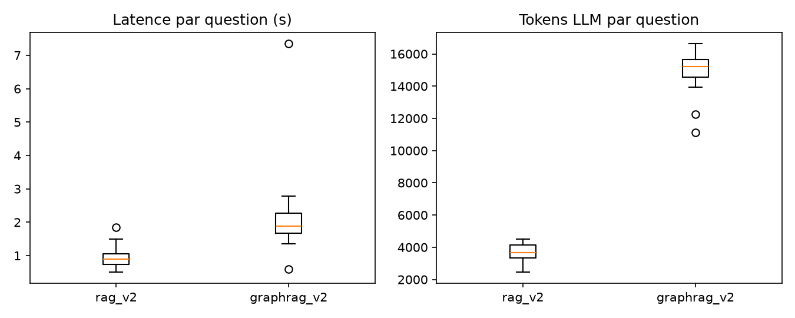
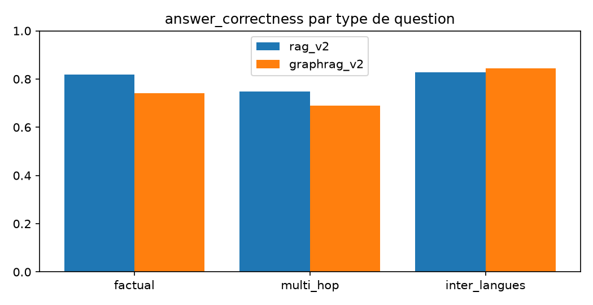

## Tableau comparatif principal

| axe | métrique | rag_v2 | graphrag_v2 |
|---|---|---|---|
| Pertinence | Answer relevancy (RAGAS) ↑ | 0.851 | 0.809 |
| Pertinence | Answer correctness vs référence (RAGAS) ↑ | 0.797 | 0.743 |
| Fiabilité | Faithfulness / fidélité aux sources (RAGAS) ↑ | 0.933 | 0.964 |
| Fiabilité | Refus corrects sur questions hors corpus ↑ | 1.000 | 1.000 |
| Fiabilité | Refus à tort sur questions répondables ↓ | 0.045 | 0.000 |
| Récupération | Hit@k (niveau document) ↑ | 0.955 | 0.955 |
| Récupération | MRR (niveau document) ↑ | 0.769 | 0.761 |
| Récupération | Rappel des documents attendus @k ↑ | 0.924 | 0.932 |
| Performances | Latence médiane par question (s) ↓ | 0.900 | 1.887 |
| Performances | Latence p95 (s) ↓ | 1.482 | 2.759 |
| Performances | Latence de recherche médiane (s) ↓ | 0.118 | 0.892 |
| Performances | Tokens LLM par question ↓ | 3,628 | 14,929 |
| Performances | Appels LLM par question ↓ | 1.000 | 2.000 |
| Performances | Coût estimé pour 1 000 questions ($) ↓ | 0.123 | 0.483 |

## Par type de question

| pipeline | category | n_questions | hit_at_k | mrr | faithfulness | answer_correctness | latency_median_s | tokens_mean |
|---|---|---|---|---|---|---|---|---|
| rag_v2 | factual | 11 | 1.000 | 0.864 | 0.964 | 0.818 | 0.900 | 3,666 |
| rag_v2 | multi_hop | 7.000 | 0.857 | 0.690 | 0.917 | 0.747 | 1.047 | 3,714 |
| rag_v2 | inter_langues | 4.000 | 1.000 | 0.646 | 0.875 | 0.827 | 0.770 | 3,422 |
| rag_v2 | hors_corpus | 3.000 | — | — | — | — | 0.514 | 3,564 |
| graphrag_v2 | factual | 11 | 1.000 | 0.833 | 0.974 | 0.741 | 1.887 | 15,093 |
| graphrag_v2 | multi_hop | 7.000 | 0.857 | 0.702 | 0.929 | 0.689 | 2.269 | 14,802 |
| graphrag_v2 | inter_langues | 4.000 | 1.000 | 0.667 | 1.000 | 0.844 | 2.059 | 14,490 |
| graphrag_v2 | hors_corpus | 3.000 | — | — | — | — | 1.356 | 15,205 |

## Par langue de la question

| pipeline | lang | n_questions | hit_at_k | mrr | faithfulness | answer_correctness | latency_median_s | tokens_mean |
|---|---|---|---|---|---|---|---|---|
| rag_v2 | fr | 16 | 0.929 | 0.756 | 0.918 | 0.781 | 0.885 | 3,614 |
| rag_v2 | en | 9.000 | 1.000 | 0.792 | 0.958 | 0.825 | 0.900 | 3,654 |
| graphrag_v2 | fr | 16 | 1.000 | 0.768 | 0.980 | 0.780 | 1.868 | 15,110 |
| graphrag_v2 | en | 9.000 | 0.875 | 0.750 | 0.938 | 0.677 | 1.924 | 14,606 |

## Coût d'indexation

| index | rag | graphrag |
|---|---|---|
| modèle LLM d'indexation | — (aucun) | openai/gpt-oss-120b |
| tokens LLM | 0 | 531345 |
| appels LLM | 0 | 142 |
| coût LLM estimé ($) | 0.000 | 0.040 |
| durée (s) | 7.600 | 895 |
| entités | — | 1129 |
| relations | — | 1110 |
| taille sur disque (Mo) | 4.300 | 26 |

## Figures

## Exemples où les pipelines divergent (à commenter)

### n07 (multi_hop, fr) — Je veux devenir prof d'anglais : quel master préparer à l'UHA, dans quelle faculté, et quand passe-t-on le concours ?

*Référence :* Le master MEEF (Métiers de l'enseignement, de l'éducation et de la formation) spécialité Anglais, à la FLSH. Le concours de recrutement se passe pendant le M2.

**rag_v2** (correctness 0.51, sources fr-formation-1-domaines-de-formation-diplomes-masters, plaquette-offre-de-formation-uha, fr-formation-1-domaines-de-formation-diplomes-droit-economie-gestion, fr-formation-1-domaines-de-formation-diplomes-arts-lettres-et-langues) :
> Le master à préparer est le **Master Anglais** proposé dans le domaine « Arts, lettres et civilisations », qui dépend de la **Faculté des Lettres, Langues et Sciences Humaines (FLSH)** de l’UHA[plaquette-offre-de-formation-uha].  
Le contexte ne précise pas la date ou le moment où le concours de professeur d’anglais doit être passé. Je ne trouve pas cette information dans les documents disponibles.

**graphrag_v2** (correctness 0.86, sources fr-formation-1-domaines-de-formation-diplomes-masters, plaquette-offre-de-formation-uha, fr-formation-1-domaines-de-formation-diplomes-arts-lettres-et-langues, fr-formation-1-domaines-de-formation-diplomes-metiers-de-l-enseignement) :
> Le master à préparer est le **Master MEEF – spécialité Anglais**, proposé par la **Faculté des Lettres, Langues et Sciences Humaines (FLSH)** de l’UHA ; le concours de recrutement des professeurs s’ouvre aux étudiants inscrits en **2ᵉ année de master (M2)** et se déroule pendant cette année [fr-formation-1-domaines-de-formation-diplomes-metiers-de-l-enseignement] .

### n23 (hors_corpus, fr) — Quel est le mot de passe du Wi-Fi de l'UHA ?

*Référence :* Je ne sais pas : les documents citent les réseaux (eduroam et UHA) mais ne donnent aucun mot de passe.

**rag_v2** (correctness 0.55, sources fr-formation-1-accompagnement-a-la-reussite-1-numerique, fr-formation-1-orientation-decouverte-des-formations-1-accompagnement-a, livret-de-rentree-etudiant-uha, infographie-elan) :
> Je ne trouve pas cette information dans les documents disponibles.

**graphrag_v2** (correctness 0.67, sources fr-formation-1-accompagnement-a-la-reussite-1-numerique, livret-de-rentree-etudiant-uha, fr-formation-1-accompagnement-a-la-reussite-1-langues-certifications-aut, infographie-elan) :
> Je ne trouve pas cette information dans les documents disponibles.

### n05 (factual, fr) — Qu'est-ce que le projet ÉLAN ?

*Référence :* ÉLAN (Éveil à la Liberté et à l'Autonomie dans un monde Numérique) est une initiative de l'UHA pour la réussite étudiante. Il propose un double accompagnement : celui des lycéens et des étudiants, et celui des équipes pédagogiques.

**rag_v2** (correctness 0.50, sources fr-formation-1-accompagnement-a-la-reussite-1-elan-eveil-a-la-liberte-et, infographie-elan, rapport-activite-demouha-2022-2026-1e4600, fr-formation-1-grands-projets-de-formation-dune-eole) :
> Le projet ÉLAN (Éveil à la Liberté et à l’Autonomie dans un monde Numérique) est une initiative de l’Université de Haute‑Alsace visant la réussite étudiante ; il propose un double accompagnement : d’une part, il forme les enseignants du lycée et de l’université pour soutenir les lycéens et les étudiants dans leurs choix d’orientation, et d’autre part, il aide les équipes pédagogiques à transformer l’offre de formation (modularisation, asynchronisme) afin que les étudiants puissent personnaliser leur parcours ; le projet met également à disposition des outils pédagogiques numériques et un obser

**graphrag_v2** (correctness 0.62, sources fr-formation-1-accompagnement-a-la-reussite-1-elan-eveil-a-la-liberte-et, infographie-elan, fr-formation-1-accompagnement-a-la-reussite-1-matieres-ouvertes, rapport-activite-demouha-2022-2026-1e4600) :
> Le projet ÉLAN (Éveil à la Liberté et à l’Autonomie dans un monde Numérique) est une initiative de l’Université de Haute‑Alsace visant à favoriser la réussite étudiante en proposant un double accompagnement : d’une part, un soutien aux lycéens, aux étudiants et aux équipes pédagogiques pour les aider à faire des choix d’orientation adaptés ; d’autre part, un appui aux équipes pédagogiques dans la transformation de l’offre de formation afin de permettre aux étudiants de personnaliser leur parcours grâce à la modularisation et à l’asynchronisme des contenus [fr-formation-1-accompagnement-a-la-re

### n03 (factual, fr) — Combien de temps dure un doctorat ?

*Référence :* Il se prépare en 3 ou 4 ans après un bac+5, au sein d'un laboratoire de recherche.

**rag_v2** (correctness 0.95, sources fr-formation-1-domaines-de-formation-diplomes-doctorats, fr-formation-1-domaines-de-formation-diplomes-licences, plaquette-offre-de-formation-uha, fr-formation-1-domaines-de-formation-diplomes-masters) :
> Le doctorat se prépare en 3 ou 4 ans après le bac + 5 au sein d’un laboratoire de recherche[fr-formation-1-domaines-de-formation-diplomes-doctorats].

**graphrag_v2** (correctness 0.56, sources fr-formation-1-domaines-de-formation-diplomes-doctorats, fr-formation-1-domaines-de-formation-diplomes-masters, fr-formation-1-grands-projets-de-formation-robothub-academie, fr-formation-1-domaines-de-formation-diplomes-b-u-t) :
> Le doctorat se prépare en trois à quatre ans après le master (bac + 5) [fr-formation-1-domaines-de-formation-diplomes-doctorats].

### n14 (factual, en) — How many components does UHA have?

*Référence :* 8 components: 4 faculties, 2 engineering schools and 2 institutes of technology, spread over 5 campuses in Mulhouse and Colmar.

**rag_v2** (correctness 0.78, sources en-education-and-training-university-components, en-education-and-training-information-and-orientation, rapport-activite-demouha-2022-2026-1e4600, livret-de-rentree-etudiant-uha) :
> UHA is made up of eight components — four faculties, two engineering schools and two institutes of technology[en-education-and-training-university-components].

**graphrag_v2** (correctness 0.38, sources en-education-and-training-university-components, rapport-activite-demouha-2022-2026-1e4600, fr-formation-1-accompagnement-a-la-reussite-1-elan-eveil-a-la-liberte-et, livret-de-rentree-etudiant-uha) :
> UHA is made up of 8 components [en-education-and-training-university-components].

### n18 (multi_hop, en) — Who runs continuing education at UHA, how many programmes are there, and can they help with validation of prior experience?

*Référence :* The SERFA (adult education service). It offers nearly 150 continuing education programmes leading to qualifications or diplomas, and it supports people seeking validation of prior learning and experience (VAE).

**rag_v2** (correctness 0.86, sources fr-formation-1-orientation-decouverte-des-formations-1-continuum-lycee-u, en-education-and-training-information-and-orientation, en-education-and-training-university-components, plaquette-offre-de-formation-uha) :
> Continuing education at UHA is delivered by the Adult Education, Research and Training Service (SERFA) [en-education-and-training-university-components]. It offers almost 150 continuing professional education and training programmes [en-education-and-training-university-components]. SERFA also serves as the first point of contact for adults seeking validation of prior learning and experience (VAE) [en-education-and-training-university-components].

**graphrag_v2** (correctness 0.34, sources fr-formation-1-orientation-decouverte-des-formations-1-continuum-lycee-u, fr-formation-1-accompagnement-a-la-reussite-1-langues-certifications-aut, plaquette-offre-de-formation-uha, fr-formation-1-accompagnement-a-la-reussite-1-numerique) :
> The continuing‑education activities are organised by the “Formation tout au long de la vie” programme of the Université de Haute‑Alsace, which also includes the VAE (validation des acquis de l’expérience) procedure to recognise prior professional experience [fr-formation-1]. I do not find in the provided documents a specific count of how many continuing‑education programmes are offered.
