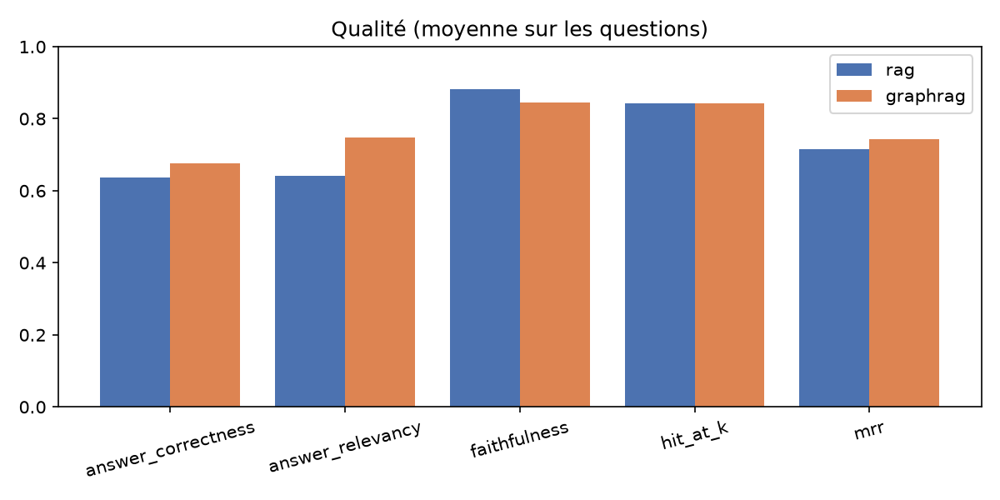

## Tableau comparatif principal

| axe | métrique | rag | graphrag |
|---|---|---|---|
| Pertinence | Answer relevancy (RAGAS) ↑ | 0.641 | 0.747 |
| Pertinence | Answer correctness vs référence (RAGAS) ↑ | 0.636 | 0.677 |
| Fiabilité | Faithfulness / fidélité aux sources (RAGAS) ↑ | 0.883 | 0.844 |
| Fiabilité | Refus corrects sur questions hors corpus ↑ | 1.000 | 1.000 |
| Fiabilité | Refus à tort sur questions répondables ↓ | 0.211 | 0.053 |
| Récupération | Hit@k (niveau document) ↑ | 0.842 | 0.842 |
| Récupération | MRR (niveau document) ↑ | 0.715 | 0.743 |
| Récupération | Rappel des documents attendus @k ↑ | 0.754 | 0.763 |
| Performances | Latence médiane par question (s) ↓ | 0.855 | 2.050 |
| Performances | Latence p95 (s) ↓ | 1.616 | 2.774 |
| Performances | Latence de recherche médiane (s) ↓ | 0.120 | 0.808 |
| Performances | Tokens LLM par question ↓ | 3,338 | 15,797 |
| Performances | Appels LLM par question ↓ | 1.000 | 2.000 |
| Performances | Coût estimé pour 1 000 questions ($) ↓ | 0.114 | 0.500 |

## Par type de question

| pipeline | category | n_questions | hit_at_k | mrr | faithfulness | answer_correctness | latency_median_s | tokens_mean |
|---|---|---|---|---|---|---|---|---|
| rag | factual | 8.000 | 1.000 | 0.854 | 0.836 | 0.755 | 0.855 | 3,340 |
| rag | inter_langues | 3.000 | 0.000 | 0.000 | 0.750 | 0.156 | 0.554 | 3,528 |
| rag | multi_hop | 8.000 | 1.000 | 0.844 | 0.967 | 0.724 | 0.983 | 3,293 |
| rag | hors_corpus | 3.000 | — | — | — | — | 0.468 | 3,263 |
| graphrag | factual | 8.000 | 0.875 | 0.833 | 0.885 | 0.697 | 1.879 | 16,120 |
| graphrag | inter_langues | 3.000 | 0.333 | 0.208 | 0.417 | 0.282 | 2.165 | 15,310 |
| graphrag | multi_hop | 8.000 | 1.000 | 0.854 | 0.950 | 0.766 | 2.190 | 15,765 |
| graphrag | hors_corpus | 3.000 | — | — | — | — | 1.391 | 15,510 |

## Par langue de la question

| pipeline | lang | n_questions | hit_at_k | mrr | faithfulness | answer_correctness | latency_median_s | tokens_mean |
|---|---|---|---|---|---|---|---|---|
| rag | fr | 15 | 0.833 | 0.729 | 0.901 | 0.601 | 0.942 | 3,403 |
| rag | en | 7.000 | 0.857 | 0.690 | 0.856 | 0.702 | 0.814 | 3,200 |
| graphrag | fr | 15 | 0.833 | 0.747 | 0.815 | 0.694 | 2.084 | 15,813 |
| graphrag | en | 7.000 | 0.857 | 0.738 | 0.889 | 0.645 | 1.900 | 15,764 |

## Coût d'indexation

| index | rag | graphrag |
|---|---|---|
| modèle LLM d'indexation | — (aucun) | openai/gpt-oss-120b |
| tokens LLM | 0 | 531345 |
| appels LLM | 0 | 142 |
| coût LLM estimé ($) | 0.000 | 0.040 |
| durée (s) | 7.600 | 895 |
| entités | — | 1129 |
| relations | — | 1110 |
| taille sur disque (Mo) | 4.300 | 26 |

## Figures

## Exemples où les pipelines divergent (à commenter)

### q01 (factual, fr) — J'ai un souci avec mon inscription, qui je contacte ?

*Référence :* Le service de la scolarité : scolarite@uha.fr ou 03 89 33 66 99.

**rag** (correctness 0.17, sources livret-de-rentree-etudiant-uha, fr-formation-1-domaines-de-formation-diplomes-droit-economie-gestion, fr-formation-1-domaines-de-formation-diplomes-sciences-humaines-et-socia) :
> Pour un problème d’inscription, adressez‑vous à la Direction des Études et de la Vie Universitaire (DEVU) : devu@uha.fr. [livret-de-rentree-etudiant-uha]

**graphrag** (correctness 0.82, sources livret-de-rentree-etudiant-uha, plaquette-offre-de-formation-uha, fr-formation-1-orientation-decouverte-des-formations-1-immersion-dans-un, plaquette-uha-formations-bi-trinationales-1e4600) :
> Pour un problème d’inscription, vous devez contacter le Service de Scolarité Centrale de l’UHA à l’adresse scolarite@uha.fr (téléphone 03 89 33 66 99) [livret-de-rentree-etudiant-uha].

### q15 (multi_hop, fr) — Je suis sportif de haut niveau : y a-t-il des matières ouvertes de sport, et qui m'accompagne ?

*Référence :* Oui, les matières ouvertes ont un domaine « Activités sportives et bien-être ». Le statut de sportif de haut niveau prévoit un suivi par les enseignants du SUAPS.

**rag** (correctness 0.09, sources fr-formation-1-accompagnement-a-la-reussite-1-matieres-ouvertes, fr-formation-1-domaines-de-formation-diplomes-droit-economie-gestion, livret-de-rentree-etudiant-uha) :
> Je ne trouve pas cette information dans les documents disponibles.

**graphrag** (correctness 0.39, sources fr-formation-1-accompagnement-a-la-reussite-1-matieres-ouvertes, livret-de-rentree-etudiant-uha, fr-formation-1-accompagnement-a-la-reussite-1, fr-formation-1-accompagnement-a-la-reussite-1-elan-eveil-a-la-liberte-et) :
> Oui, des matières ouvertes sont proposées dans le domaine « Activités sportives et bien‑être », accessible à tous les étudiants ; le Service Universitaire des Activités Physiques et Sportives (SUAPS) vous accompagne spécifiquement en tant que sportif de haut niveau en vous offrant un statut dédié et des aménagements (ex. : report d’examens, accès à la salle de musculation, etc.)[fr-formation-1-accompagnement-a-la-reussite-1-matieres-ouvertes][livret-de-rentree-etudiant-uha]

### q21 (inter_langues, fr) — Est-ce que l'UHA a un domaine de formation sur le développement durable ?

*Référence :* Oui : « Science & Sustainability » (sciences et durabilité) fait partie des cinq grands domaines de formation de l'UHA, avec Interculturality ; Law, Politics & Societal studies ; Management ; Digital studies & Innovation industries.

**rag** (correctness 0.30, sources plaquette-offre-de-formation-uha) :
> Oui, l’UHA propose des formations axées sur le développement durable, notamment dans le domaine « Sciences, Technologies, Santé » avec des parcours tels que « Risques et environnement », « Ingénierie environnementale et énergies nouvelles » et le master « Sciences et génie des matériaux » qui prépare à développer des procédés et matériaux durables [plaquette-offre-de-formation-uha::1]. De plus, le projet Mat‑Light 4.0 vise explicitement à former la nouvelle génération aux procédés et matériaux durables pour la transition énergétique et environnementale [plaquette-offre-de-formation-uha::1].

**graphrag** (correctness 0.48, sources plaquette-offre-de-formation-uha, rapport-activite-demouha-2022-2026-1e4600, livret-de-rentree-etudiant-uha, fr-formation-1-facultes-iut-ecoles-d-ingenieurs-uha-business-school) :
> Oui, l’UHA propose un domaine de formation dédié à la transition écologique et sociétale, intitulé « Sciences de la transition écologique et sociétale », qui porte sur le développement durable [plaquette-offre-de-formation-uha].

### q18 (multi_hop, en) — Where can I take French classes, and does that service also offer a digital certification?

*Référence :* At the Learning Center, which also supports the Pix digital certification.

**rag** (correctness nan, sources en-education-and-training-fields-of-training-and-qualifications, en-education-and-training-information-and-orientation, fr-formation-1-accompagnement-a-la-reussite-1-langues-certifications-aut, plaquette-uha-formations-bi-trinationales-1e4600) :
> You can attend face‑to‑face French Langue Étrangère (FLE) courses offered by the university’s Learning Center (ForCe) – these classes are reserved for foreign students[fr-formation-1-accompagnement-a-la-reussite-1-langues-certifications-aut].  
The Learning Center also provides the Pix digital certification, which evaluates and attests to students’ digital skills[fr-formation-1-accompagnement-a-la-reussite-1-langues-certifications-aut].

**graphrag** (correctness 0.92, sources en-education-and-training-fields-of-training-and-qualifications, rapport-activite-demouha-2022-2026-1e4600, fr-formation-1-accompagnement-a-la-reussite-1-langues-certifications-aut, plaquette-uha-formations-bi-trinationales-1e4600) :
> You can take French‑as‑a‑foreign‑language courses at the University of Haute‑Alsace’s Learning Center, which organizes these language courses for non‑native speakers [en-education-and-training-fields-of-training-and-qualifications]. The same Learning Center also provides digital certification (the Pix certification) for students [fr-formation-1-accompagnement-a-la-reussite-1-pedagogie-universitaire-in].

### q19 (multi_hop, en) — How close is UHA to the Swiss border, and can I take courses at other universities nearby?

*Référence :* UHA is at the heart of the Three Frontiers region, right on Basel's doorstep. Yes: through Eucor – The European Campus (5 universities within about 80 km), enrolled students can take courses at the other member universities and have them validated in their own programme.

**rag** (correctness 0.67, sources plaquette-offre-de-formation-uha, en-education-and-training-international-education, en-education-and-training-information-and-orientation, fr-formation-1-accompagnement-a-la-reussite-1-mobilites-internationales) :
> UHA is situated in the heart of the Upper Rhine region, essentially on Basel’s doorstep, so it lies right next to the Swiss border[en-education-and-training-international-education]. Through the Eucor – The European Campus network, any UHA student can enrol in courses at the other member universities within about 80 km and have those credits recognised by UHA[en-education-and-training-international-education].

**graphrag** (correctness nan, sources plaquette-offre-de-formation-uha, en-education-and-training-international-education, fr-formation-1-accompagnement-a-la-reussite-1-mobilites-internationales, livret-de-rentree-etudiant-uha) :
> UHA is located right on the doorstep of Basel, giving it immediate proximity to the Swiss border[en-education-and-training-international-education]. Through its membership in the Eucor – The European Campus network, any UHA student can enrol in courses at partner universities such as the University of Basel, Fribourg or Karlsruhe and have the credits recognised by UHA[en-education-and-training-international-education].

### q20 (inter_langues, fr) — Est-ce que la plupart des formations sont à temps plein, avec un stage ensuite ?

*Référence :* Oui : la majorité des formations de l'UHA se suivent à temps plein à l'université, puis sont complétées par une période de stage en entreprise. Certaines formations sont aussi proposées en apprentissage.

**rag** (correctness 0.08, sources fr-formation-1-formation-tout-au-long-de-la-vie, fr-formation-1-domaines-de-formation-diplomes-licences, fr-formation-1-formations-en-alternance-apprentissage, fr-formation-1) :
> Je ne trouve pas cette information dans les documents disponibles.

**graphrag** (correctness nan, sources fr-formation-1-formation-tout-au-long-de-la-vie, fr-formation-1-domaines-de-formation-diplomes-masters, fr-formation-1-formations-en-alternance-apprentissage, fr-formation-1-domaines-de-formation-diplomes-diplomes-d-ingenieurs) :
> Oui, la plupart des formations sont dispensées à temps plein et comprennent ensuite un stage long obligatoire — notamment les masters, qui intègrent généralement une période de stage long dans leur cursus [fr-formation-1-domaines-de-formation-diplomes-masters] ; de même, le diplôme d’ingénieur prévoit un stage long de fin d’études en troisième année [fr-formation-1-domaines-de-formation-diplomes-diplomes-d-ingenieurs].
